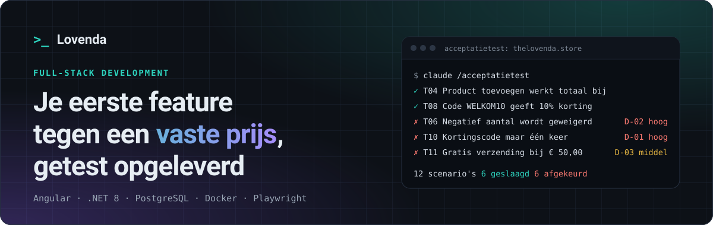

<a href="https://lovenda.nl"></a>

<p align="center">
  <a href="https://lovenda.nl"><b>lovenda.nl</b></a> &nbsp;·&nbsp;
  <a href="https://thelovenda.store">Demo-webwinkel</a> &nbsp;·&nbsp;
  <a href="https://thelovenda.store/rapport/">Voorbeeldrapport</a> &nbsp;·&nbsp;
  <a href="mailto:info@lovenda.nl">info@lovenda.nl</a>
</p>

## Wat ik doe

<table>
  <tr>
    <td width="33%" valign="top">
      <h3><code>{ }</code> Freelance development</h3>
      Features, bugfixes en onderhoud in webapplicaties met Angular, .NET en PostgreSQL. De eerste feature bouw ik tegen een vaste prijs.<br><br>
      <b>Eerste feature vaste prijs</b><br>
      <sub>daarna € 70 per uur</sub>
    </td>
    <td width="33%" valign="top">
      <h3><code>✓</code> AI-acceptatietest</h3>
      Eén testcyclus op je webapplicatie, met een samenvatting voor de beslisser en een defectrapport voor het team.<br><br>
      <b>Vanaf € 750</b><br>
      <sub>vaste prijs per cyclus</sub>
    </td>
    <td width="33%" valign="top">
      <h3><code>&gt;_</code> Claude Code-implementatie</h3>
      Projectinstructies, skills, permissies en een review- en testwerkwijze in je eigen repository.<br><br>
      <b>Per dag</b><br>
      <sub>prijs op aanvraag</sub>
    </td>
  </tr>
</table>

## Technieken

`Angular` `TypeScript` `C#` `.NET 8` `ASP.NET Core` `PostgreSQL` `Entity Framework Core` `Docker` `Playwright` `Claude Code`

## Werkwijze

```text
01 intake    Kennismaking van een half uur
02 offerte   Vaste prijs met acceptatiecriteria
03 branch    Uitvoering op een eigen branch of in je testomgeving
04 review    Pull request of rapport: wat is gewijzigd, hoe het is getest
```

Ik werk niet met productiegegevens. Claude Code schrijft en test mee; ik lees elke wijziging zelf na.

## Voorbeelden

| Repository | Wat je er ziet |
|---|---|
| [thelovenda-showcase](https://github.com/Kraka-cmd/thelovenda-showcase) | Demo-webwinkel met zes bewust ingebouwde fouten en het [rapport](https://thelovenda.store/rapport/) van de testcyclus die ze alle zes vond |
| [claude-code-teamsetup](https://github.com/Kraka-cmd/claude-code-teamsetup) | Een Claude Code-teaminrichting om te kopiëren: projectinstructies, permissies en skills |
| [lovenda-site](https://github.com/Kraka-cmd/lovenda-site) | De broncode van [lovenda.nl](https://lovenda.nl) |

## Contact

Ligt er een feature die blijft liggen? Mail naar [info@lovenda.nl](mailto:info@lovenda.nl) met om welke applicatie het gaat en wat er moet komen.
